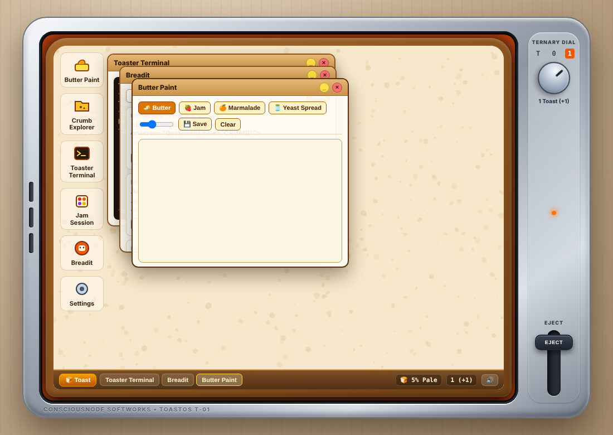

# ToastOS

**A graphical operating system that runs inside a single slice of toast.**

▶ **Play it:** https://consciousnode.github.io/ToastOS/

Press the toaster lever to boot. The bread is the screen, the crust is the bezel, and **browning is the system clock**: the longer it runs, the darker the toast gets, until it burns and starts dropping crumbs. Push the lever again to eject and reboot on a fresh slice.

## Features
- **Balanced-ternary toast dial:** T (−1 Frozen: icy windows, sluggish dragging), 0 (Bread), 1 (+1 Toast: browns faster).
- **Golden toast (35–75%) changes how apps behave:** butter spreads wider, and Jam Session's synth warms up.
- **Apps:** Butter Paint, Crumb Explorer (with a Crumb Tray you empty by shaking the toaster), Toaster Terminal (14 commands, try `butter`), Jam Session (step sequencer), Breadit (a social feed for sandwiches) and Settings (white, rye, sourdough or pumpernickel screen texture).
- One self-contained HTML file: no dependencies, works offline, all sound synthesized with Web Audio.

## Credits
- Idea and goof energy: Kham, ConsciousNode SoftWorks.
- Spec: Kehai Interim ([SPEC.md](SPEC.md)).
- Built by Gemini 4 Hydrogen, whose own build report is in [REPORT.md](REPORT.md).
- Post-delivery fix (Kehai): Breadit now escapes post text, so a post can't run script.

MIT License.
